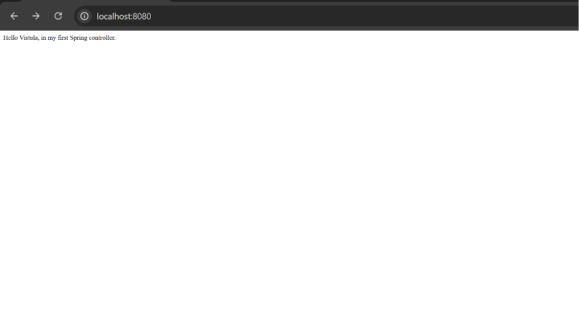
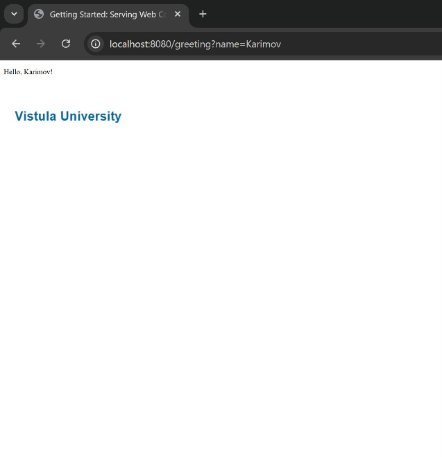

# First Project Java Spring

Demo project for Spring Boot with Thymeleaf templating engine.

## Technologies

- Java 25
- Spring Boot 3.2.5
- Spring MVC
- Thymeleaf

## How to Run

1. Open the project in IntelliJ IDEA
2. Run `FirstProjectJavaSpringApplication.java`
3. Open browser at `http://localhost:8080`

## Endpoints

| URL | Description |
|-----|-------------|
| `GET /` | Returns "Hello Vistula, in my first Spring controller." |
| `GET /greeting?name=Karimov` | Returns greeting page with the given name |

## Screenshots

### Home page

### Greeting page

